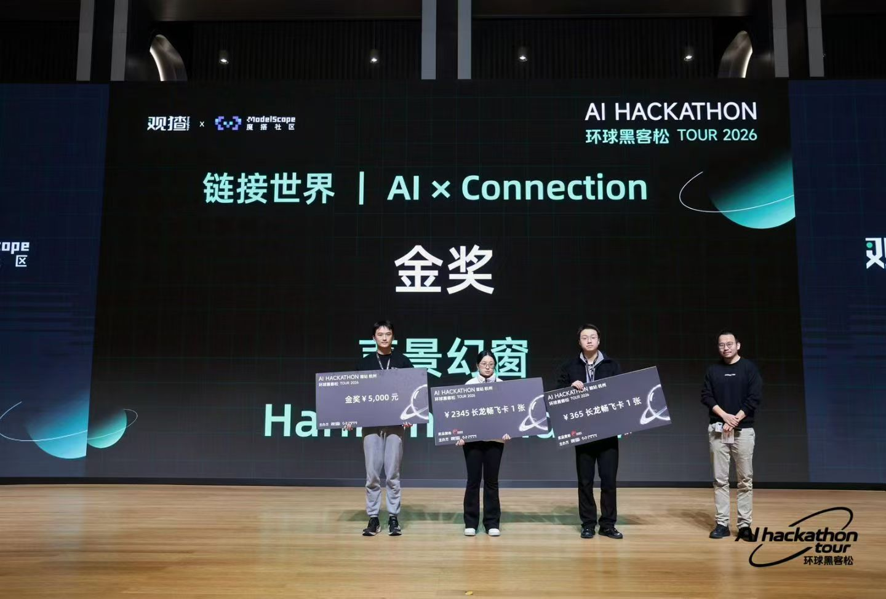
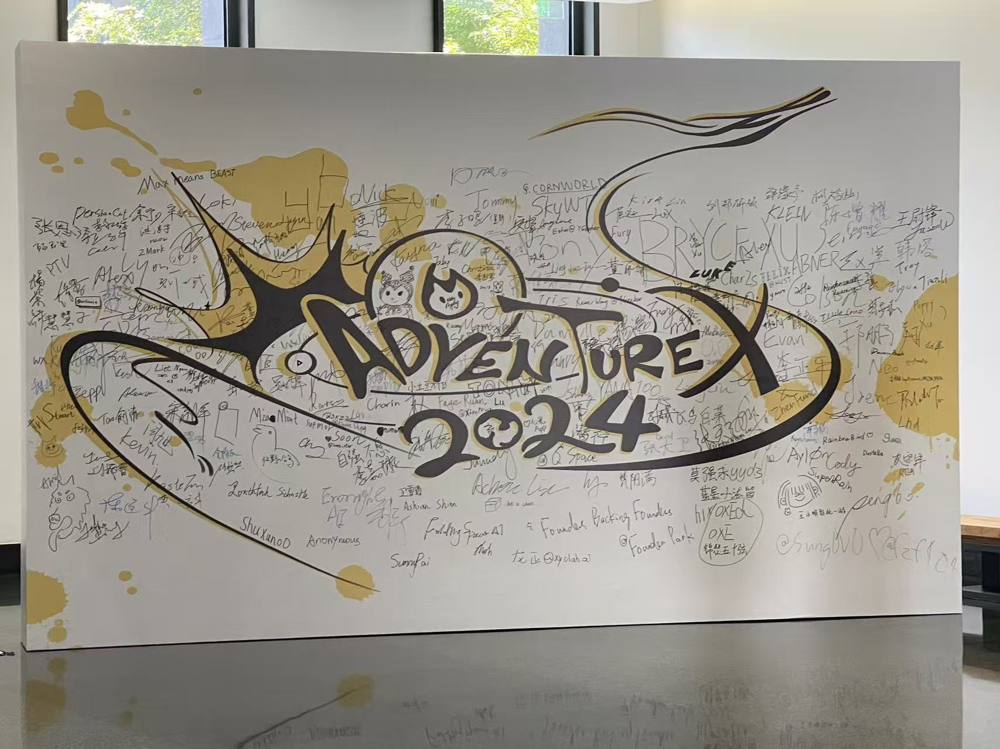
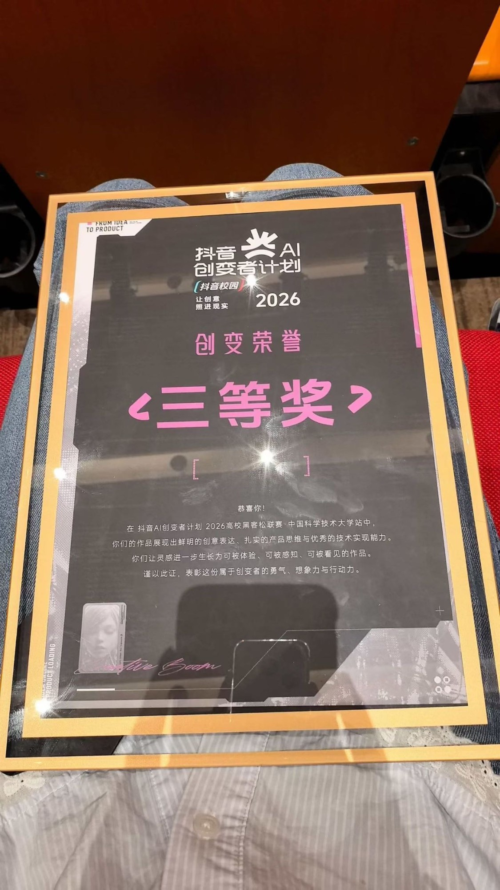
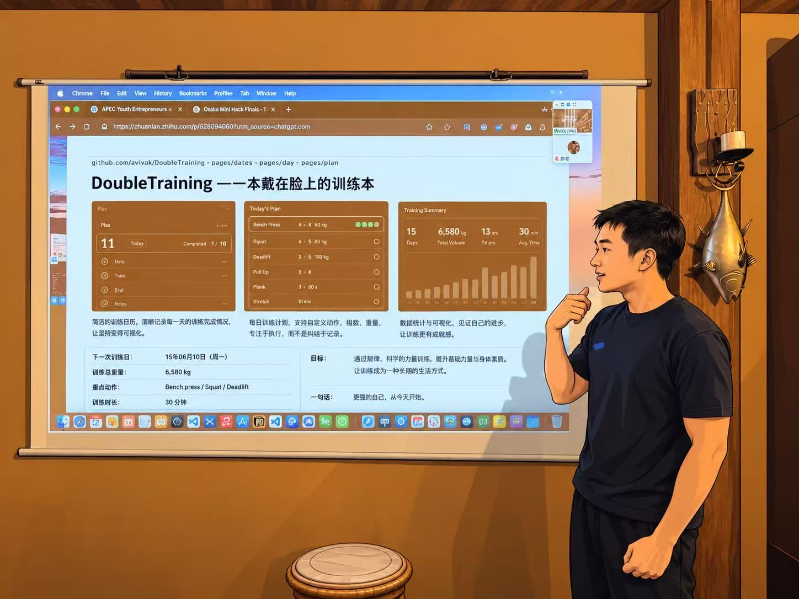
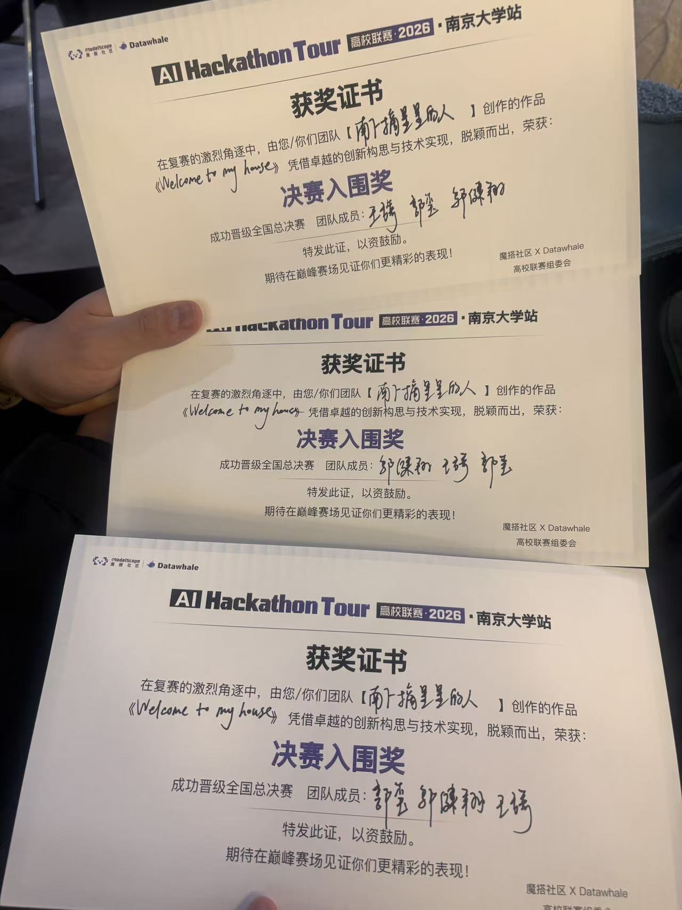
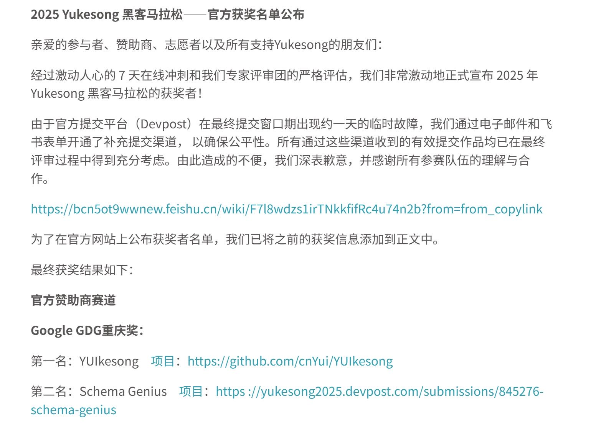
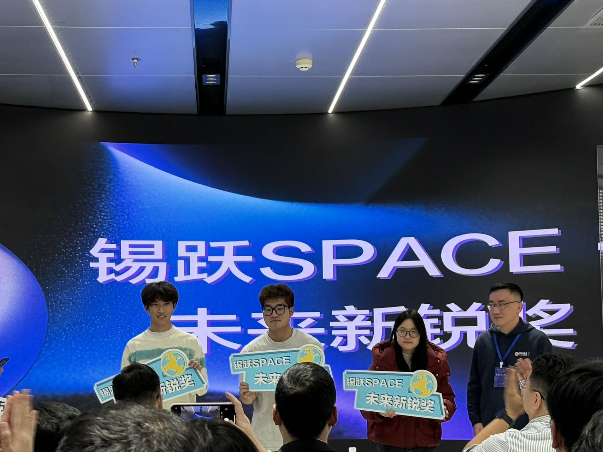
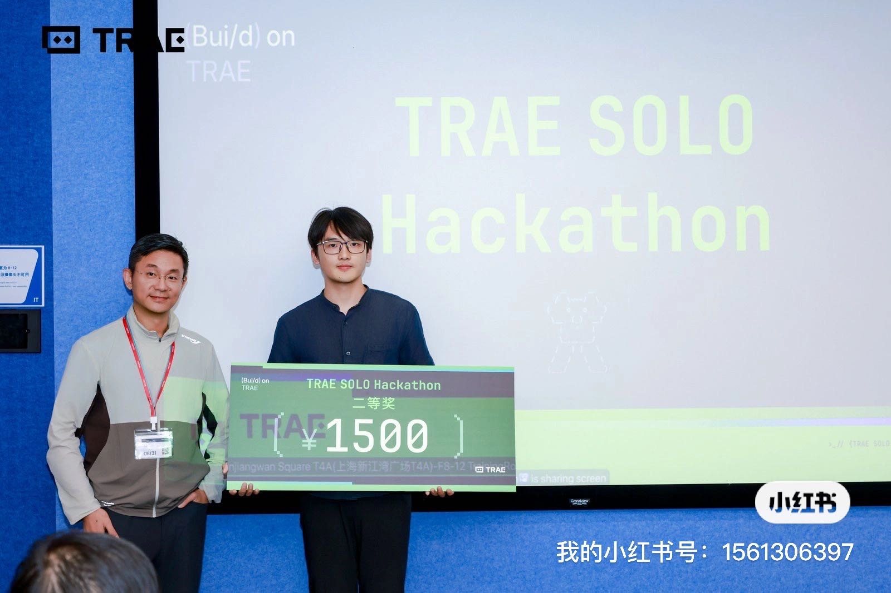
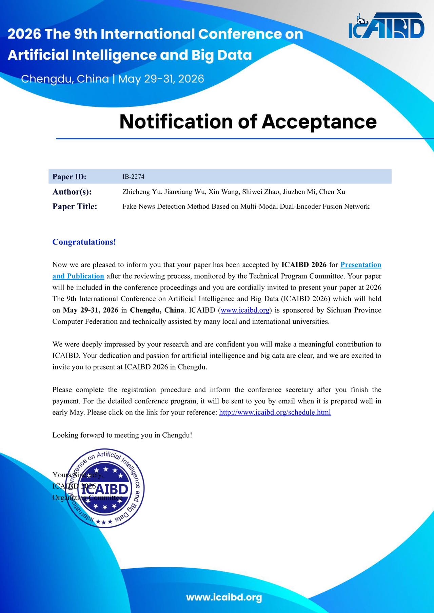

🌐 [中文](README.md) · [English](README.en.md) · **日本語**

# Yui / 悠一

Yui（邬健翔 / WU JIANXIANG）です。**福井大学**大学院で情報工学を学んでおり、**AI Mage**（アニメ IP × AI の東京のスタートアップ）でインターンをしています。**AI Native Developer** として、Coding Agent のワークフロー、Agentic RAG、AI ネイティブなプロダクトに取り組んでいます。

個人でソフトウェア開発・デザイン・創作もしています。AI を後付けの機能として扱うのではなく、AI の能力を軸にプロダクトを設計することを大切にしています。要件の分解、ワークフロー設計、Agent システム、RAG / GraphRAG から、ユーザー体験と最終的な検証までを一貫して手がけます。

- 🌐 個人サイト：[aaccx.pw](https://aaccx.pw)
- 🔌 AI API 中継サイト（天才程序员小站）：[aaccx.pw/home](https://aaccx.pw/home)
- 📕 小紅書（Xiaohongshu）：[プロフィール](https://www.xiaohongshu.com/user/profile/62b04c20000000001b0250b3)
- 🤖 このリンクをあなたの AI Agent に渡すと、私のことを把握してくれます：[aaccx.pw/SKILL.md](https://aaccx.pw/SKILL.md)
- 📧 メール：<xiaobianfuai@gmail.com>

## 関心分野

- AI ネイティブなプロダクト
- Coding Agent のワークフロー
- Agentic RAG / GraphRAG
- LangChain / LangGraph
- マルチモーダル API とプロンプトワークフロー
- シンプルで直感的、使いやすいデジタルプロダクト

## 技術とツール

- 開発：Python、React、TypeScript、HTML / CSS、Flutter、WeChat ミニプログラム、Android
- AI システム：RAG、Agentic RAG、GraphRAG、LangChain、LangGraph、ベクトル検索
- ワークフロー：Dify、n8n、Coze、LangGraph
- ツール：Figma、VS Code、Cursor、Trae、Codex、Windsurf

## 経歴

- **AI Mage** — インターン（アニメ IP 監修 × AI）· 2026.9 – 2026.10
  アニメ制作会社向け（ToB）のマルチモーダル Agentic RAG を開発する会社。作画担当者が「ある話数のキャラクターの特定の動き」を新しい話数の作画参考として探すときに、プロダクトで直接検索できる。Agentic RAG のうち RAG 部分のデータアライメント（整合）を担当。
- **National Energy Research Institute** — 研究開発 / 運用インターン · 2025.9 – 2026.3
  マルチモーダル RAG の開発・デプロイ・運用を担当。ドキュメントからテキスト / 画像 / 表を抽出し、ローカルの視覚モデルでタグ付け、Embedding 化と検索テストを実施。Docker でマルチモーダル Agentic RAG の対話 WebUI（フロントエンド・バックエンド一体型）を構築。

## 学歴

- **福井大学** 大学院工学研究科 知識社会基礎工学専攻（情報工学）· 2026.4 – 2028.3

## 語学・資格

- JLPT N2 · TOEIC 850 · TOEFL iBT 84

## ハッカソン・受賞歴

  
  

- 🥉 Douyin（抖音）AI 創変者計画 2026 大学ハッカソンリーグ（中国科学技術大学会場）3 位 · 2026
- 🥈 Rokid 大阪 Mini Hackathon 準優勝（2 位）· 2026.09（プロジェクト [DoubleTraining](https://github.com/cnYui/doubletraining)）
- 🎖️ AI Hackathon Tour 南京大学会場 決勝進出 · 2026.03（プロジェクト [Welcometomyhouse](https://github.com/cnYui/Welcometomyhouse)）
- 🥇 グローバル・ハッカソン（环球黑客松）金賞 · 2026.01
- 🥇 渝客松（Yukesong）Google GDG トラック 1 位 · 2025.11（プロジェクト [YUIkesong](https://github.com/cnYui/YUIkesong)）
- 🥉 無錫 Rokid AR AI コンテスト 3 位 · 2025.11
- 🏅 Tencent Cloud オンライン・ハッカソン 受賞 · 2025.09（プロジェクト [healthy-pet-companion](https://github.com/cnYui/healthy-pet-companion)）
- 🥈 TRAE SOLO ハッカソン 上海会場 2 位 · 2025.08（プロジェクト [Github_MBTI_Gallary](https://github.com/cnYui/Github_MBTI_Gallary)）

<table>
  <tr>
    <td align="center" valign="top" width="33%"> Douyin AI 創変者計画・中国科学技術大学会場 3 位</td>
    <td align="center" valign="top" width="33%"> Rokid 大阪 Mini Hackathon 準優勝（2 位）</td>
    <td align="center" valign="top" width="33%"> AI Hackathon Tour 南京大学会場 決勝進出</td>
  </tr>
  <tr>
    <td align="center" valign="top" width="33%"> 渝客松 Google GDG トラック 1 位（公式受賞者発表のスクリーンショット）</td>
    <td align="center" valign="top" width="33%"> Rokid AI トラック 3 位（錫躍 SPACE 未来新鋭賞）</td>
    <td align="center" valign="top" width="33%"> TRAE SOLO ハッカソン 上海会場 2 位</td>
  </tr>
</table>

## 論文

- **Fake News Detection Method Based on Multi-Modal Dual-Encoder Fusion Network**（共著）· ICAIBD 2026（第 9 回 人工知能・ビッグデータ国際会議、成都）に採択・発表 · 2026.05

## キーワード

- 福井大学 大学院生
- AI Mage インターン（アニメ IP 監修 × AI）
- AI Native Developer
- ハッカソンの常連参加者
- プロダクト志向の AI Coding 実践者
- デザインの美意識、プロダクトの完成度、検証のループを重視

## 趣味で作っているミニゲーム（アニメ二次創作）

好きなアニメ作品を、ブラウザでそのまま遊べるストーリーゲームにしています。すべて [aaccx.pw](https://aaccx.pw) で公開していて、開くだけで遊べます。PC（キーボード）とスマホ / タブレット（横向きのタッチ操作）の両方に対応しています。

| ゲーム | 概要 | オンラインで遊ぶ | ソース |
| --- | --- | --- | --- |
| 銀魂 ピクセルシアター | 2D ストーリーアクション：会話を進め、自由に歩き回り、戦闘へ。序章から終章まで全 15 章 | [aaccx.pw/gintama](https://aaccx.pw/gintama/) | [gintama-pixel-game](https://github.com/cnYui/gintama-pixel-game) |
| JoJo スターダストクルセイダース | 2D ストーリーアクション：スタンドシステムを搭載。東京からカイロまで、すべてのスタンド使いと戦う | [aaccx.pw/jojo](https://aaccx.pw/jojo/) | [jojo-pixel-game](https://github.com/cnYui/jojo-pixel-game) |
| Rusty Lake: Paradise 3D | Three.js で作った 3D 一人称視点の謎解き。現在は第一の災い「血」まで完成 | [aaccx.pw/rusty-lake](https://aaccx.pw/rusty-lake/) | [rusty-lake-paradise-3d](https://github.com/cnYui/rusty-lake-paradise-3d) |
| ベルセルク | ピクセルのストーリーアクション：ガッツを操作する第 1 章「鷹の団」の体験版 | [aaccx.pw/berserk](https://aaccx.pw/berserk/) | 未公開 |

すべて非営利のファン作品であり、キャラクターおよび原作の著作権は原作者に帰属します。
